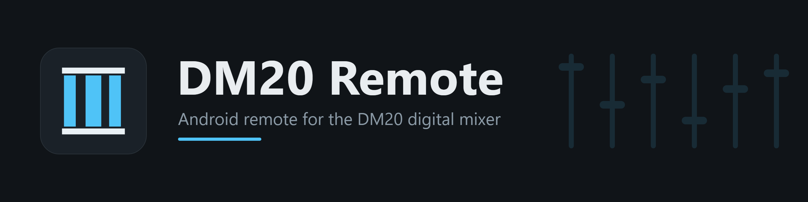
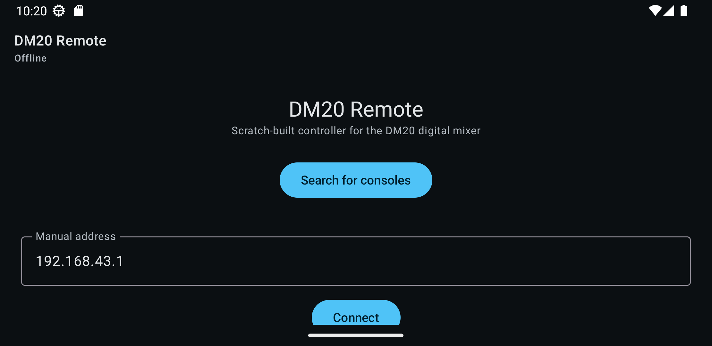
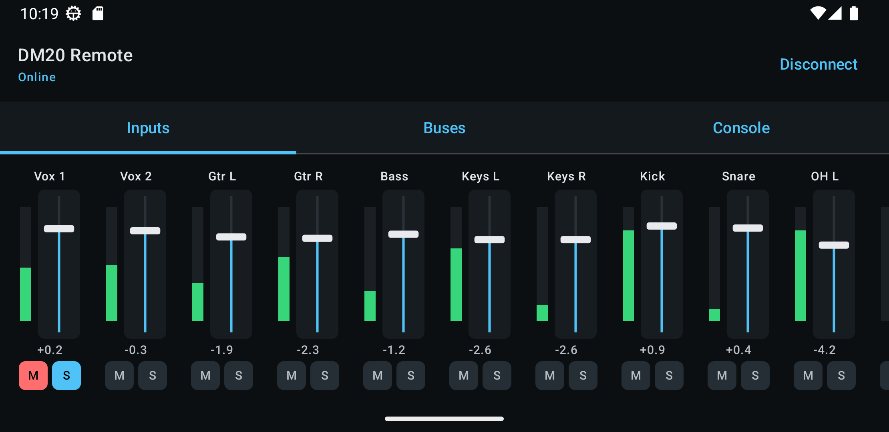
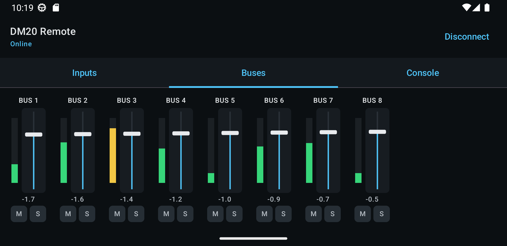
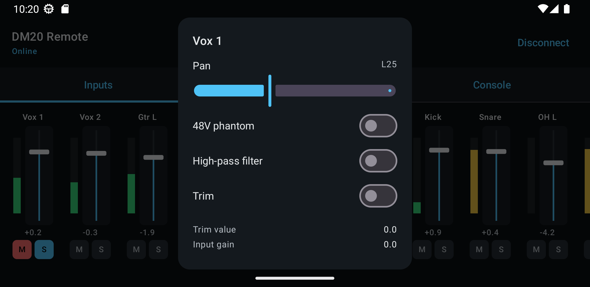
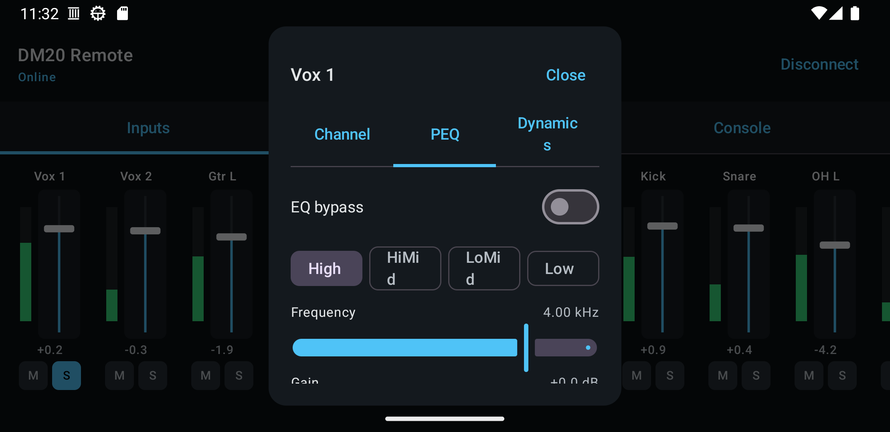
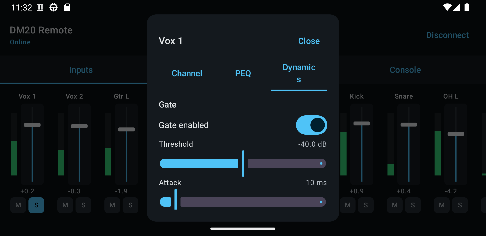
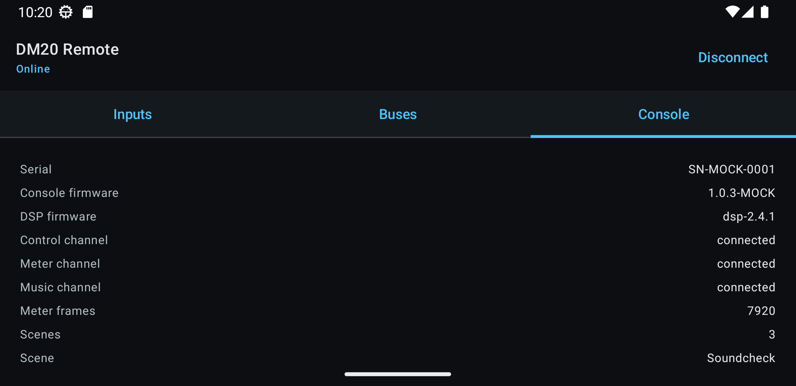
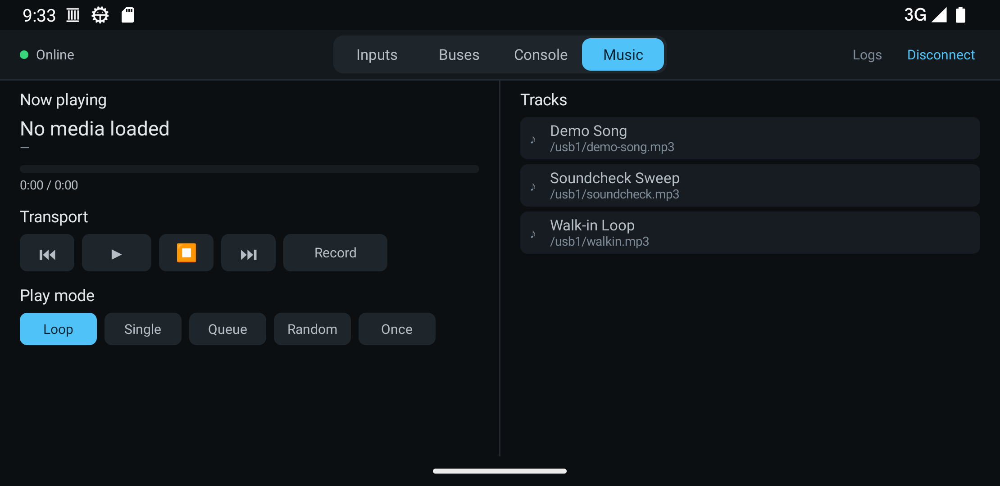

# DM20 Remote

A scratch-built Android remote control for the **DM20 digital mixer**, written from scratch as a
replacement for the original `com.esunny.sound` 1.0.3 app.

The original app targets `minSdk 16 / targetSdk 26` and therefore triggers the "built for an older
version of Android" warning on modern devices. This project targets `targetSdk 36` (`minSdk 24`) so it
installs and runs normally on current Android versions.

**Everything here is original work.** No assets, layouts, drawables, sounds or code from the original
application are reused. The UI is plain Jetpack Compose with generic graphics, the launcher/status
icons are hand-written vector drawables, and the README banner is an original, hand-authored SVG.
The protocol implementation is a self-contained reimplementation of the wire format documented in
[`docs/protocol-spec.md`](docs/protocol-spec.md), which was recovered by static analysis (see
[`docs/rea-report.md`](docs/rea-report.md)).

## Screenshots

> Captured on Android 13 against the bundled mock console ([`tools/mock-console.js`](tools/mock-console.js)),
> not physical hardware.

**Connect** — auto-discover a console on the LAN, or type its address:



**Inputs** — 12 input strips with live level meters, dB faders, mute and solo:



**Buses** — the eight mix buses, same interaction model:



**Channel detail** — pan, 48 V phantom power, high-pass filter, trim and input gain:



**PEQ** — the four-band parametric EQ, with a bell or shelf shape per band:



**Dynamics** — gate and compressor for the selected input:



**Console** — firmware, serial, channel state, meter rate and the scene list:



**Music** — transport and recorder control: play/pause, stop, previous/next, record, the play-mode
selector and the console's file list. Position advances from the music channel, and every button is
confirmed by the console before the display changes:



## Status

Working today:

- UDP discovery of a console on the LAN (probe `5A 5A 5A 5A` to `255.255.255.255:6399`), plus manual
  address entry (default `192.168.43.1`, the console's own AP address).
- Control channel (`6400`) handshake and full `SKDMCData` snapshot decode: input names, bus names,
  firmware/serial, scene list.
- Meter channel (`6401`): 80 live level meters at ~10 Hz.
- Music channel (`6402`): decodes the bare delimited `PlayCommand` stream (framing recovered in
  [`docs/protocol-spec.md`](docs/protocol-spec.md) §3.4), so the Console tab reports the current song and
  whether it is playing.
- **Music** tab: transport control (play/pause, stop, previous/next, record) and an `EnmPlayMode`
  selector (Loop / Single / Queue / Random / Once). Commands go out on `192` as a `PlayCommand` and the
  display follows the console's `195` echo, so nothing is shown optimistically; the file list comes from
  the console's `193` `MusicList`, and the controls are disabled with an explanation while the music
  channel is down.
- Input strips on a landscape mixing surface with per-channel level meter, fader (dB), mute and solo.
- Bus strips with meter, fader, mute and solo.
- Input channel detail sheet from the recovered model (pan, 48 V, HPF, trim, gain).
- Tabbed per-channel editors: **PEQ** (four bands × frequency/gain/Q, bell or shelf shape on the high and
  low bands) and **dynamics** (gate and compressor). Commands go out on `104`/`106` and the UI updates
  when the console mirrors them back on `103`/`105`.
- Foreground service (`connectedDevice`) that keeps the sockets alive while the app is backgrounded.
- Opt-in **wire log** for field debugging: enable it on the connection screen and every control/meter/
  music frame, plus UDP discovery, is timestamped and dumped (hex + decoded protobuf text) to a text
  file that can be shared or saved to Downloads from inside the app — see
  [Capturing a wire log](#capturing-a-wire-log). This is how issue
  [`009`](issues/009-hardware-verification.md) will be checked against real hardware.
- Edge-to-edge rendering (opt-in via `enableEdgeToEdge()` + `safeDrawingPadding()`), so on Android 15+
  the header and strips stay clear of the status bar, gesture bar and landscape display cutouts.

Known gaps (all documented in the protocol spec's "Open questions"):

- Scene recall/select, scene import/export and the library browsers are not built yet.
- Per-channel bus sends (the eight mix buses + LR) are not surfaced yet — see
  [`issues/010-bus-sends.md`](issues/010-bus-sends.md).
- Commands are sent as fire-and-forget; the UI reflects a change when the console mirrors it back.

## How this was built

This app was produced by an AI coding agent (the [OpenCode](https://opencode.ai) harness, running 
Big Pickle model) working under human direction; it was not hand-typed line by line.

- **Protocol recovery** was done with **REA**, a reverse-engineering toolkit, by *static* analysis of
  the original `com.esunny.sound` 1.0.3 APK — DEX classes, string pools and the embedded protobuf
  `descriptorData` blobs. The original app was **never executed**. The full write-up, including the
  recovered constants, protoId tables and message classes, is in
  [`docs/rea-report.md`](docs/rea-report.md).
- **The application** (Kotlin + Jetpack Compose UI, framing, protocol codec, foreground service) was
  written from scratch, then compiled, unit-tested (102 tests) and driven end to end against a mock
  console on Android 13 and Android 16 emulators. The verification log is in
  [`docs/protocol-spec.md`](docs/protocol-spec.md) §10.
- **Human direction** chose the architecture, scoped the features, resolved the protocol ambiguities
  and reviewed the result.

### Provenance note

`DM20 Remote` is an independent client for the DM20 mixer's own network protocol, implemented for
interoperability. It contains **no code, resources, drawables, sounds or other assets** taken from the
original application; the protocol was reconstructed from the shipped binary so that the two can talk to
each other. The original APK is **not** distributed with this repository. "DM20" and any related names
or marks belong to their respective owners; this project is not affiliated with or endorsed by them.

## Android version compatibility

| Requirement (Android 13 → 16) | How it is met |
|---|---|
| "Built for an older version" warning | `targetSdk 36` (the original was 26) |
| Edge-to-edge enforcement (API 35+) | `enableEdgeToEdge()` plus `safeDrawingPadding()` on the root, so content clears the status bar, gesture bar and landscape display cutouts |
| Foreground service type (API 34+) | The service declares `connectedDevice` and the app holds the prerequisite network permissions |
| Notification permission (API 33+) | Requested when a console connects; the app stays fully usable when it is denied |
| 16 KB page size (API 35+) | Only native libraries are Compose's `libandroidx.graphics.path.so`; `zipalign -c -P 16` confirms the APK is aligned |

## Requirements

- JDK 17 or newer (17–21 tested)
- Android SDK with platform 36 and build-tools 35.0.0

The Gradle wrapper downloads Gradle itself, so no separate Gradle install is needed. No administrator
access is required; everything can be user-local.

Point the build at your toolchain with **either** of these:

- Set `JAVA_HOME` and `ANDROID_HOME` in your environment (and `sdk.dir` in `local.properties` if you
  prefer), **or**
- Copy the template and edit it:

  ```powershell
  Copy-Item local-env.example.ps1 local-env.ps1
  # then edit the two paths in local-env.ps1
  ```

Both `local.properties` and `local-env.ps1` are git-ignored, so personal paths are never committed.

## Build

```powershell
. .\local-env.ps1          # if you use the template; otherwise ensure JAVA_HOME is set
.\gradlew.bat :app:assembleDebug
```

The APK lands at `app/build/outputs/apk/debug/app-debug.apk`.

## Test

```powershell
. .\local-env.ps1
.\gradlew.bat :app:testDebugUnitTest
```

The suite covers the wire framing (including the init request's special 14-byte form and the music
channel's bare delimited form), the fader position ↔ dB conversion, the EQ and dynamics engineering-unit
ranges, the meter slot map, the state-preserving command builders, the echo-driven store fold, and a
socket-level test that drives the real `ConsoleClient` against an in-process `ServerSocket`.

## Install

```powershell
adb install -r app\build\outputs\apk\debug\app-debug.apk
```

## Permissions

| Permission | Why |
|---|---|
| `INTERNET` | TCP control/meter channels and UDP discovery |
| `ACCESS_NETWORK_STATE`, `ACCESS_WIFI_STATE`, `CHANGE_WIFI_STATE`, `CHANGE_NETWORK_STATE`, `CHANGE_WIFI_MULTICAST_STATE` | Join the console's Wi-Fi network / AP and enumerate broadcast interfaces |
| `FOREGROUND_SERVICE`, `FOREGROUND_SERVICE_CONNECTED_DEVICE` | Keep the control and meter sockets open in the background |
| `POST_NOTIFICATIONS` | Optional. Only used to show the ongoing "connected to console" notification. The app works fine if it is denied — the request is best-effort and the service still runs. |

`MainActivity` is `sensorLandscape`, matching the layout of a mixing console surface.

## Testing without hardware

[`tools/mock-console.js`](tools/mock-console.js) is a small reference implementation of the recovered
protocol (UDP `6399`, control `6400`, meter `6401`, music `6402`). It answers discovery, returns a `SKDMCData`
snapshot plus a `MusicList` (`193`) on the init request, streams meter frames and a bare delimited
`PlayCommand` on the music channel, applies transport commands (`192`: select, play/pause, stop, record,
play mode) to its fake player and reports the new state on `195`, and mirrors accepted changes back on the
matching odd protoId (`104 → 103`, `106 → 105`, `110 → 109`, `114 → 113`). Ports can be overridden with
`DM20_DISCOVERY_PORT`, `DM20_CONTROL_PORT`, `DM20_METER_PORT` and `DM20_MUSIC_PORT`.

```powershell
node tools/mock-console.js
```

From an emulator, point the app's manual address field at `10.0.2.2`, which reaches the host loopback.
(UDP broadcast discovery is not reliably forwarded into the emulator, so use manual entry there.)

### Verified configurations

| Emulator AVD | API level | Result |
|---|---|---|
| `Pixel_3a_API_33_x86_64` | 33 (Android 13) | install/launch, connect, snapshot, meters, input + bus commands, disconnect |
| `Pixel_8_API_36` | 36 (Android 16) | same, plus edge-to-edge insets and the `connectedDevice` foreground service under Android 14+/16 FGS rules |

Both runs used the same mock and produced identical protocol traffic, so the wire handling is
version-independent. On API 36 the notification permission was deliberately **denied** while connected;
the UI stayed Online, the service reported `isForeground=true types=0x10` (connected device), and
commands still applied, confirming the degraded path.

To recreate the Android 16 AVD (the system image is `system-images;android-36;google_apis;x86_64`):

```powershell
sdkmanager "system-images;android-36;google_apis;x86_64"
avdmanager create avd -n Pixel_8_API_36 -k "system-images;android-36;google_apis;x86_64" -d pixel_8
emulator -avd Pixel_8_API_36
```

## Capturing a wire log

When you connect to real hardware for the first time — or when a connection fails — you can capture
every byte the app sends and receives, so a session can be inspected later without `adb logcat`.

1. On the connection screen, switch on **Wire log (for debugging)**. The choice is remembered, so
   logging resumes across a relaunch.
2. Connect (or try to connect). UDP discovery, the control handshake, the meter stream and the music
   channel are all recorded.
3. Tap **View wire log** — from the connection screen, or from the header while connected.

Every frame is timestamped and tagged with its direction, channel and protoId, followed by a hex dump
and, where one is available, the decoded protobuf text:

```
2026-10-13 14:22:31.482  TX  control  OUT_MIC_OUTPUT_PART(110)  12 B
    0000  08 04 10 00 00 00 15 00 00 00 00 00  |.............|
2026-10-13 14:22:31.501  RX  control  IN_MIC_OUTPUT_PART(109)  12 B
    0000  08 04 10 00 00 00 15 00 00 00 00 00  |.............|
    moduleId: 4
```

Identical consecutive meter frames are collapsed into a single "skipped" line so an idle console does
not flood the file, and the file is capped (16 MB) if a session runs very long.

The log screen can **Share** the file (Android share sheet → email, Drive, USB), **Save to Downloads**
(API 29+, so it shows up in the Files app), **Copy** it to the clipboard, or **Clear** the view. The
file itself is also kept at `Android/data/com.dm20remote/files/logs/wire-<timestamp>.log`.

The capture path was exercised on the `Pixel_3a_API_33_x86_64` emulator against the mock: flipping the
switch creates `wire-<timestamp>.log`, the connect handshake plus meter and music frames land in it
(hex, decoded protobuf text and the compact dB readout), and **Share**, **Save to Downloads** and
**Clear** all behave.

## Project layout

```
app/src/main/java/com/dm20remote/
  net/        Framing, ProtoIds, ProtoCodec, Discovery, ConsoleClient, ConsoleCommands, Units, Meters
  model/      ConsoleState, ConsoleStore, ConsoleSession
  debug/      WireLog, WireLogFormat (opt-in wire capture for field debugging)
  service/    ConsoleService (foreground service)
  ui/         AppRoot, ConnectScreen, MixerScreen, ChannelStrip, ChannelDetail, PeqEditor, DynamicsEditor, MusicPane, WireLogScreen, ParamControls, components/
  proto/      generated from app/src/main/proto/dm20.proto (protobuf-lite)
  Dm20App     Application entry point (installs the wire log)
docs/         recovered protocol spec, static-analysis report and the full protobuf schema
tools/        mock console for testing without hardware
```

## Documentation

- [`docs/protocol-spec.md`](docs/protocol-spec.md) — the recovered wire protocol (framing, discovery,
  protoId tables) and the end-to-end verification results.
- [`docs/rea-report.md`](docs/rea-report.md) — the static-analysis report of the original app.
- [`docs/dm20-recovered-schema.proto`](docs/dm20-recovered-schema.proto) — the complete reconstructed
  protobuf schema (57 recovered `.proto` files merged).
- [`app/src/main/proto/dm20.proto`](app/src/main/proto/dm20.proto) — the cleaned-up schema the app
  actually builds against.
- [`issues/`](issues/README.md) — the backlog: known gaps and planned work, one Markdown file per issue.

## License

[MIT](LICENSE).
